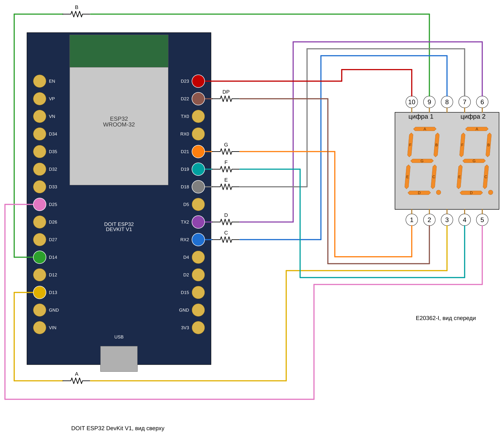

# 0. Путеводитель: от деталей до работающего индикатора

Начинайте отсюда. Документ ведёт по шагам и на каждом шаге отправляет в нужный подробный документ. Отмечайте пройденное.

**Цель этапа 1:** один индикатор E20362 (2 цифры) подключён к ESP32, проходит самотест сегментов и показывает счётчик секунд 00–59.

## Шаг 1. Детали

- [ ] ESP32 **DOIT DevKit V1** (30 выводов) и USB-кабель **с передачей данных** (не только зарядка).
- [ ] Индикатор **TOYO E20362-I-UA3**: что это, ножки, как проверить мультиметром — [components/E20362-I-UA3.md](components/E20362-I-UA3.md).
- [ ] 8 резисторов **470 Ом**, макетная плата, ~10 проводов — [03-hardware.md, 3.2](03-hardware.md#32-что-понадобится).

Индикатор снят с платы сетевого обогревателя: саму плату к ESP32 не подключать и не включать.

## Шаг 2. Компьютер (один раз)

- [ ] Arduino IDE, пакет ESP32, драйвер CH9102, COM-порт виден — [01-environment-setup.md](01-environment-setup.md).
- [ ] Внешние библиотеки не нужны.

## Шаг 3. Сборка схемы — USB отключён

- [ ] **USB вынут.**
- [ ] Индикатор: точками вниз, ножки 1–5 — нижний ряд — [вид спереди](components/E20362-I-UA3.md#контакты).
- [ ] 8 линий сегментов: пин ESP32 → резистор 470 Ом → ножка индикатора; 2 анода — напрямую — [03-hardware.md, 3.3](03-hardware.md#33-схема): монтажная схема, принципиальная схема и таблица пинов.
- [ ] На плате GPIO16 и GPIO17 подписаны **RX2** и **TX2**.

## Шаг 4. Проверка перед включением

- [ ] На **каждом** из 8 проводов сегментов (D13, D14, RX2, TX2, D18, D19, D21, D22) есть резистор — ни одного сегмента напрямую.
- [ ] Без резисторов только два провода: **D23 → ножка 10** и **D25 → ножка 5**.
- [ ] К индикатору **не подключены** 3V3, GND, VIN.
- [ ] Голые выводы резисторов не касаются соседних.

Схема безопасна при любом состоянии пинов (в том числе со старой прошивкой на плате): ток ограничен резисторами, максимум ~22 мА через пин анода — расчёт в [03-hardware.md](03-hardware.md#почему-резисторы-470-ом--1-ком-а-не-330).

## Шаг 5. Заливка прошивки

- [ ] Вставить USB.
- [ ] Arduino IDE: открыть `firmware/led_clock/led_clock.ino`, плата **DOIT ESP32 DEVKIT V1**, порт `COMx`, **Загрузка** — [02-firmware.md, 2.2](02-firmware.md#22-заливка). `config.h` не нужен.
- [ ] Повисло на `Connecting....___` — зажать **BOOT** на плате до начала записи.

## Шаг 6. Первый запуск и самотест

- [ ] Монитор порта: **115200**, окончание строки «Новая строка». Нажать **EN** — лог с начала — [02-firmware.md, 2.3](02-firmware.md#23-ожидаемый-лог).
- [ ] ~1 с горит **«8.8.»** — все сегменты обеих цифр.
- [ ] Сегменты по одному: левая цифра A…G, точка, затем правая. В логе на каждом шаге — `[TEST] цифра N, сегмент X (ножки …, GPIO …)`.
- [ ] Затем счётчик **00–59**, точка после левой цифры мигает раз в секунду.

## Шаг 7. Ручная проверка

Команды в мониторе порта — [02-firmware.md, 2.4](02-firmware.md#24-команды):

- [ ] `42` → на индикаторе «42»; `7` → « 7»; `07` → «07».
- [ ] `t` — повторить самотест, `s` — вернуть секунды.

## Шаг 8 (по желанию). Понять основы

- [ ] Учебный скетч «одна цифра»: цифра из константы, без динамической индикации, с упражнениями — [05-one-digit.md](05-one-digit.md).

## Если что-то не так

| Что видно | Куда смотреть |
|---|---|
| Нет COM-порта, не заливается | [04-troubleshooting.md](04-troubleshooting.md), первые строки |
| На шаге самотеста горит не тот сегмент / не горит | строка `[TEST]` из лога → [04-troubleshooting.md](04-troubleshooting.md) |
| Не горит целая цифра | провод анода (D23 → 10, D25 → 5) |
| Сегмент под подозрением | проверка мультиметром — [components/E20362-I-UA3.md](components/E20362-I-UA3.md#проверка-мультиметром) |

Любые перестановки проводов — **с отключённым USB**.

## Где что лежит

| Документ | О чём |
|---|---|
| [01-environment-setup.md](01-environment-setup.md) | среда разработки |
| [02-firmware.md](02-firmware.md) | настройки, заливка, лог, команды |
| [03-hardware.md](03-hardware.md) | схемы подключения, резисторы и токи |
| [04-troubleshooting.md](04-troubleshooting.md) | симптом → причина → решение |
| [05-one-digit.md](05-one-digit.md) | учебный скетч: как зажигается одна цифра |
| [components/](components/) | описания деталей и даташиты |
| [diagrams/schematics.ipynb](diagrams/schematics.ipynb) | исходник всех схем ([как править](../../../docs/diagrams.md)) |

## Дальше

Этап 1 пройден → следующие этапы — в [README проекта](../README.md#этапы): PNP-ключи на анодах, второй индикатор (4 цифры), время по Wi-Fi.
