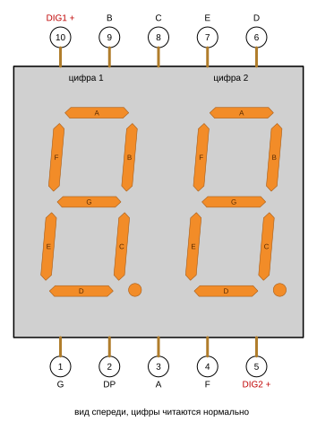
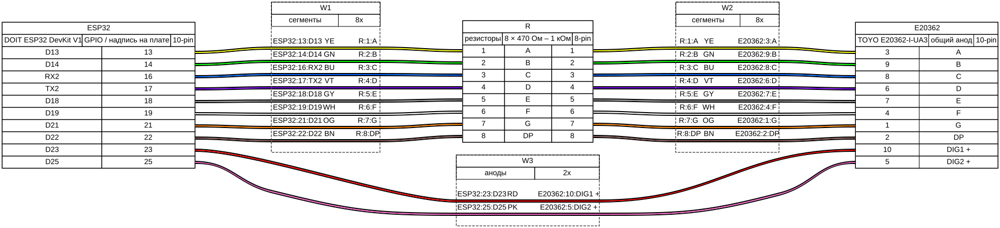

# 3. Подключение

> **Перед подключением отключите USB от ESP32.** Любые перекоммутации — только на обесточенной плате.
>
> Индикатор снят с платы сетевого обогревателя (230 В). Саму плату к ESP32 **не подключать** и не включать — используем только выпаянный индикатор.

Этап 1 — **один** индикатор (2 цифры), без транзисторов.

## 3.1 Индикатор TOYO E20362-I

Маркировка на корпусе — `E20362-I-UA3-8`: 2 цифры высотой 9,2 мм, 10 ножек, **общий анод** (буква `I`), оранжевый.
Подробно (контакты, комбинации, напряжения, даташиты): [components/E20362-I-UA3.md](components/E20362-I-UA3.md).

Сегменты у обеих цифр общие (ножка 3 — это A и левой, и правой цифры). Какая цифра загорится, решает, на какой анод (10 или 5) подан плюс. Поэтому прошивка зажигает цифры по очереди, ~250 раз в секунду каждую, — глазу кажется, что горят обе (мультиплексирование).

## 3.2 Что понадобится

| Компонент | Кол-во |
|---|---|
| ESP32 DOIT DevKit V1 | 1 |
| Индикатор E20362-I | 1 |
| Резистор **470 Ом – 1 кОм** | 8 |
| Макетная плата, провода | ~10 |

Транзисторы на этом этапе не нужны.

## 3.3 Схема

| Ножка индикатора | Сигнал | ESP32 | Надпись на плате | Через |
|---|---|---|---|---|
| 3 | A | GPIO 13 | D13 | резистор |
| 9 | B | GPIO 14 | D14 | резистор |
| 8 | C | GPIO 16 | **RX2** | резистор |
| 6 | D | GPIO 17 | **TX2** | резистор |
| 7 | E | GPIO 18 | D18 | резистор |
| 4 | F | GPIO 19 | D19 | резистор |
| 1 | G | GPIO 21 | D21 | резистор |
| 2 | DP | GPIO 22 | D22 | резистор |
| 10 | анод левой цифры | GPIO 23 | D23 | напрямую |
| 5 | анод правой цифры | GPIO 25 | D25 | напрямую |

На DOIT DevKit V1 GPIO 16 и 17 подписаны не `D16`/`D17`, а `RX2`/`TX2`. Цвета проводов на схеме — рекомендация для макетки.

GND и 3V3 к индикатору не подключаются: плюс даёт GPIO анода, минус — GPIO сегмента (в состоянии LOW).

Пины можно поменять в `config.h` — см. [02-firmware.md](02-firmware.md).

### Почему резисторы 470 Ом – 1 кОм, а не 330

Анод цифры питается прямо от одного GPIO и отдаёт ток **всех** горящих сегментов этой цифры. При «8.» горят 8 сегментов.
Ток сегмента ≈ (3,3 В − ~2 В на сегменте) / R:

| Резистор | Ток сегмента | Ток пина анода при «8.» | |
|---|---|---|---|
| 1 кОм | ~1,3 мА | ~10 мА | безопасно, яркость умеренная |
| 470 Ом | ~2,8 мА | ~22 мА | ярче, в пределах возможностей пина |
| 330 Ом | ~4 мА | ~32 мА | слишком близко к пределу 40 мА — **только с транзисторами** |

Прошивка выставляет пинам анодов максимальную нагрузочную способность (`GPIO_DRIVE_CAP_3`). Яркость упрётся в этот предел. Сделать ярче можно на этапе с PNP-транзисторами (тогда подойдут и 330 Ом).

## 3.4 Включение

1. Ещё раз сверить провода по таблице 3.3, проверить, что на каждой линии сегмента есть резистор.
2. Подключить USB, открыть монитор порта 115200.
3. Смотреть на индикатор во время самотеста:
   - 1,2 с горит «8.8.» — все сегменты обеих цифр;
   - затем по одному сегменту: левая цифра A, B, C, D, E, F, G, DP, потом правая. Каждый шаг пишется в лог с номерами ножек;
   - после этого — счётчик секунд 00–59, точка после левой цифры мигает раз в секунду.
4. Если на каком-то шаге загорелся не тот сегмент или ничего не горит — запомнить строку `[TEST]` из лога и смотреть [04-troubleshooting.md](04-troubleshooting.md).

Дальше: [04-troubleshooting.md](04-troubleshooting.md).
