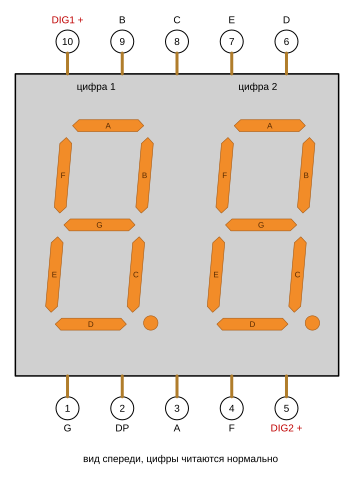
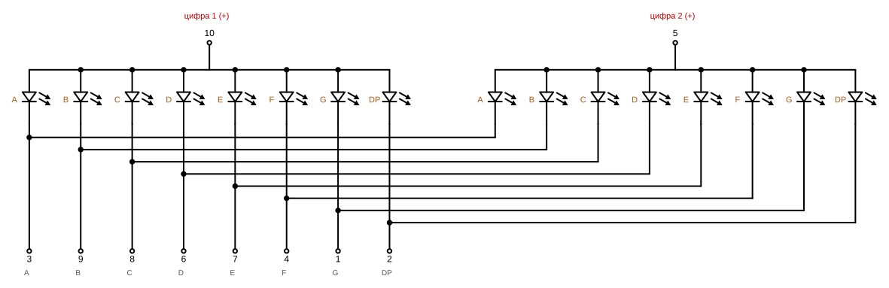

# TOYO E20362-I-UA3 — двухразрядный семисегментный индикатор

Выпаян с платы электрообогревателя (на плате их было два, вместе давали «88:88»).

| | |
|---|---|
| Производитель | TOYO LED Electronics |
| Тип | 2 цифры, 7 сегментов + точка у каждой цифры |
| Схема | **общий анод** (CODE I) |
| Цвет | **оранжевый** (amber), λd ≈ 605 нм |
| Кристалл | AlGaInP (ultra bright) |
| Высота цифры | 9,2 мм (0,36″) |
| Корпус | 15,0 × 14,0 × 7,2 мм |
| Выводы | 10, шаг 2,54 мм, расстояние между рядами 10,16 мм, Ø 0,5 мм |
| Бессвинцовый | да (Pb-free) |

## Маркировка

На корпусе: `E20362-I-UA3-8 W2148 8 M2`

| Часть | Значение |
|---|---|
| `E20362` | серия: 2 цифры, 0,36″ |
| `I` | схема **общий анод** (`L` — общий катод) |
| `UA3` | цвет кристалла: Ultra bright Amber, 605 нм |
| `8` | цвет лицевой панели — серый (`0` — чёрный) |
| `W2148` | `W` — белые сегменты (полный код заказа `E20362-I-UA3-8-W`); `2148` — вероятно, код даты: 2021 год, 48-я неделя |
| `8 M2` | не расшифровано, вероятно, партия или сортировка по яркости |

Расшифровка `8`, `W` и даты основана на описаниях продавцов TOYO, а не на официальном документе.

## Контакты

Вид **спереди**, цифры читаются нормально, точки внизу. Вывод 1 — левый нижний (в даташите отмечен «PIN1» под левой цифрой).



Нижний ряд — выводы 1…5 слева направо, верхний — 10…6 слева направо (нумерация идёт по кругу против часовой стрелки).

| Вывод | Назначение | Полярность |
|---|---|---|
| 1 | сегмент **G** (средний) | катод (−) |
| 2 | точка **DP** | катод (−) |
| 3 | сегмент **A** (верхний) | катод (−) |
| 4 | сегмент **F** (верхний левый) | катод (−) |
| 5 | **общий анод цифры 2** (правой) | анод (+) |
| 6 | сегмент **D** (нижний) | катод (−) |
| 7 | сегмент **E** (нижний левый) | катод (−) |
| 8 | сегмент **C** (нижний правый) | катод (−) |
| 9 | сегмент **B** (верхний правый) | катод (−) |
| 10 | **общий анод цифры 1** (левой) | анод (+) |

## Внутренняя схема

В каждой цифре 8 светодиодов. Их аноды соединены вместе и выведены на вывод 10 (цифра 1) или 5 (цифра 2). Катоды одноимённых сегментов обеих цифр соединены между собой: вывод 3 — это катод сегмента A **и** левой, **и** правой цифры.



Поэтому одновременно независимо управлять обеими цифрами нельзя. Их зажигают по очереди с частотой в сотни герц (динамическая индикация).

## Что загорается при какой комбинации

Сегмент светится, когда **плюс** подан на анод цифры, а **минус** (через резистор) — на вывод сегмента.

| Сегмент | Минус (−) на вывод | Плюс на **10** → горит в цифре 1 | Плюс на **5** → горит в цифре 2 |
|---|---|---|---|
| A | 3 | верхняя полоска левой цифры | верхняя полоска правой цифры |
| B | 9 | верхняя правая | верхняя правая |
| C | 8 | нижняя правая | нижняя правая |
| D | 6 | нижняя полоска | нижняя полоска |
| E | 7 | нижняя левая | нижняя левая |
| F | 4 | верхняя левая | верхняя левая |
| G | 1 | средняя полоска | средняя полоска |
| DP | 2 | точка после левой цифры | точка после правой цифры |

Плюс на 10 **и** 5 одновременно — один и тот же сегмент загорится в обеих цифрах.

### Цифры 0–9

Анод нужной цифры (10 или 5) — на плюс, на минус — перечисленные выводы:

| Цифра | Сегменты | Выводы на минус | Маска (bit0=A … bit6=G) |
|---|---|---|---|
| 0 | A B C D E F | 3, 9, 8, 6, 7, 4 | `0x3F` |
| 1 | B C | 9, 8 | `0x06` |
| 2 | A B D E G | 3, 9, 6, 7, 1 | `0x5B` |
| 3 | A B C D G | 3, 9, 8, 6, 1 | `0x4F` |
| 4 | B C F G | 9, 8, 4, 1 | `0x66` |
| 5 | A C D F G | 3, 8, 6, 4, 1 | `0x6D` |
| 6 | A C D E F G | 3, 8, 6, 7, 4, 1 | `0x7D` |
| 7 | A B C | 3, 9, 8 | `0x07` |
| 8 | все | 3, 9, 8, 6, 7, 4, 1 | `0x7F` |
| 9 | A B C D F G | 3, 9, 8, 6, 4, 1 | `0x6F` |

Точка DP (вывод 2) добавляется к любой цифре: маска `| 0x80`.

## Напряжение и ток

Официальный даташит E20362 содержит только корпус и схему. Электрический даташит на код `UA3` у TOYO закрыт. Значения ниже взяты из даташита TOYO **CODE UR3** — кристалл того же класса (AlGaInP ultra bright), красного цвета. Для оранжевого UA3 они близки, но это **ориентир, а не паспорт**.

| Параметр | Значение | Условие |
|---|---|---|
| Прямое напряжение Vf на сегмент | **≈ 2,0 В** (тип. 2,05 В, макс. 2,4 В) | при 20 мА |
| Vf при малом токе | ≈ 1,8–1,9 В | 1–5 мА (по графику Vf–I) |
| Длительный ток сегмента | **макс. 30 мА** | |
| Импульсный ток сегмента | макс. 90 мА | скважность 1/10, импульс 0,1 мс |
| Обратное напряжение | **макс. 5 В** | |
| Мощность | макс. 72 мВт на сегмент | |
| Рабочая температура | −40…+85 °C | |
| Пайка | 260 °C, 3 с | 1,6 мм от корпуса |

Нагрузка на общий анод — ток всех горящих сегментов цифры: при «8.» до 8 × I сегмента.

### Как выбрать резистор

На каждую линию сегмента — свой резистор (не один общий на анод: иначе яркость будет зависеть от числа горящих сегментов).

```
R = (U питания − Vf) / I сегмента,   Vf ≈ 2,0 В
```

| Питание | 2 мА (тускло, но видно) | 5 мА (нормально) | 10 мА (ярко) |
|---|---|---|---|
| 3,3 В (ESP32) | ~680 Ом | ~270 Ом | ~130 Ом |
| 5 В | ~1,5 кОм | ~620 Ом | ~300 Ом |

При динамической индикации каждая цифра горит половину времени (для двух цифр), поэтому видимая яркость ниже, чем при постоянном свечении с тем же током.

Ограничения со стороны ESP32 (анод напрямую от GPIO, без транзистора) — см. [../03-hardware.md](../03-hardware.md), раздел «Почему резисторы 470 Ом – 1 кОм».

### Минимальное напряжение

Светодиод начинает заметно светиться примерно с 1,7–1,8 В на сегменте. Питания 3,3 В хватает с запасом. Мультиметр в режиме прозвонки диодов (обычно 2,5–3 В на щупах) зажигает сегмент слабо или не зажигает совсем — это не признак неисправности.

## Проверка мультиметром

1. Режим проверки диодов (▶|).
2. Красный щуп (+) — на вывод **10** (цифра 1) или **5** (цифра 2).
3. Чёрный щуп (−) — на вывод сегмента из таблицы выше.
4. Исправный сегмент слабо светится, мультиметр показывает ~1,6–1,9 В. Щупы наоборот — ничего (обратное включение).

Проверено на этом экземпляре: 10+/3−, 10+/1−, 10+/9−, 10+/8−, 5+/1−, 5+/3− — светятся.

## Документы

- [TOYO_E20362.pdf](datasheets/TOYO_E20362.pdf) — официальный даташит серии: корпус и внутренняя схема (CODE L / CODE I). Источник: [eurocom-c.com](https://eurocom-c.com/image/catalog/pdf/LED_products/Dual_displays/E20362-LI_Toyo.pdf).
- [TOYO_CODE_UR3.pdf](datasheets/TOYO_CODE_UR3.pdf) — электрические параметры кристалла UR3 (соседний код, используется как ориентир). Источник: [rhydolabz.com](https://www.rhydolabz.com/documents/7segmentUR3-ULTRA-BRIGHT-RED.pdf).
- Цвет и длина волны UA3: [eurocom-c.com, E20362-I-UA3-8-W](https://eurocom-c.com/en/e20362-i-ua3-8-w-toyo).
