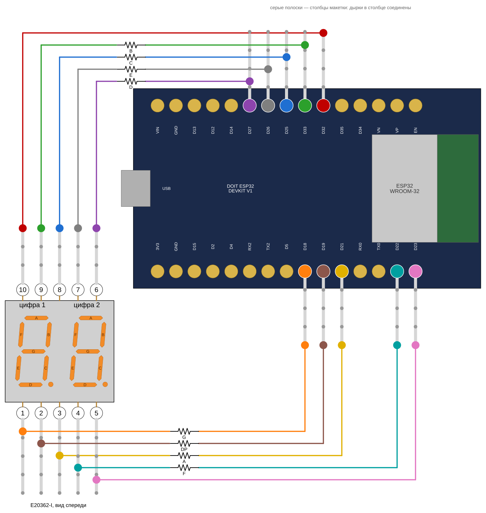

# led_clock_v2 — часы на семисегментных индикаторах, удобная разводка

ESP32 управляет выпаянными с платы электрообогревателя индикаторами [TOYO E20362-I-UA3](docs/components/E20362-I-UA3.md) (2 цифры, общий анод, оранжевые) методом динамической индикации. Конечная цель — часы ЧЧ.ММ с точным временем по Wi-Fi (NTP).

**v2** — та же прошивка, что в проекте `led_clock`, но с разводкой **без пересечений проводов**: верхний ряд ножек индикатора (10…6) подключён к верхнему ряду платы (плата горизонтально, USB слева), нижний (1…5) — к нижнему.



**С чего начать:** [docs/00-guide.md](docs/00-guide.md) — путеводитель по шагам от деталей до работающего индикатора, со ссылками на подробные документы.

## Разводка v2

| Ряд индикатора | Ножка | Сигнал | Пин ESP32 |
|---|---|---|---|
| верхний ← верхний ряд платы | 10 | DIG1 + (анод левой цифры) | D32 |
| | 9 | B | D33 |
| | 8 | C | D25 |
| | 7 | E | D26 |
| | 6 | D | D27 |
| нижний ← нижний ряд платы | 1 | G | D18 |
| | 2 | DP | D19 |
| | 3 | A | D21 |
| | 4 | F | D22 |
| | 5 | DIG2 + (анод правой цифры) | D23 |

Плата на макетке лежит горизонтально (USB слева), индикатор — слева внизу. Провода к верхнему ряду ножек идут буквой «Г» (влево, затем вниз), к нижнему — вниз, затем влево; пересечений нет.

Сегменты — через резисторы 470 Ом, аноды — напрямую. Подробно: [docs/03-hardware.md](docs/03-hardware.md).

## Этапы

| Этап | Что | Статус |
|---|---|---|
| 1 | Один индикатор (2 цифры): мультиплексирование, самотест, счётчик секунд 00–59 | **пройден, проверен на железе** |
| 2 | PNP-ключи на анодах (ярче, разгрузка GPIO) | |
| 3 | Второй индикатор: 4 цифры, общие линии сегментов | |
| 4 | Wi-Fi + NTP, часовой пояс Киева с летним временем, формат ЧЧ.ММ | |

Подробный план следующих шагов (черновик, с датчиками температуры и пищалкой): [docs/plan.md](docs/plan.md).

## Структура

```
projects/led_clock_v2/
├── docs/
│   ├── components/               # описание индикатора и даташиты (E20362-I-UA3)
│   ├── diagrams/                 # schematics.ipynb -> SVG-схемы для документов
│   ├── 00-guide.md               # путеводитель: все шаги по порядку со ссылками
│   ├── 01-environment-setup.md   # общая установка ESP32
│   ├── 02-firmware.md            # конфиг, заливка, лог, команды
│   ├── 03-hardware.md            # схемы подключения v2
│   ├── 04-troubleshooting.md     # типовые проблемы
│   └── 05-one-digit.md           # учебный скетч: как зажигается одна цифра
└── firmware/
    ├── led_clock_v2/             # основная прошивка
    │   ├── led_clock_v2.ino
    │   └── config.example.h      # необязательный конфиг -> скопировать в config.h
    └── one_digit_v2/               # учебный: одна цифра из константы, без мультиплексирования
        └── one_digit_v2.ino
```

## Порядок сборки

| Шаг | Что делаем | ESP32 | Периферия |
|---|---|---|---|
| [00](docs/00-guide.md) | путеводитель: весь путь по шагам с чек-листами | — | — |
| [01](docs/01-environment-setup.md) | среда | по USB | не нужна |
| [02](docs/02-firmware.md) | заливка, проверка лога | по USB | не нужна |
| [03](docs/03-hardware.md) | подключение индикатора (USB вынут!) | USB вынуть → подключить → вставить | индикатор + 8 резисторов |
| [05](docs/05-one-digit.md) | учебный скетч: одна цифра — понять основы | по USB | та же схема |

## Быстрый старт

Коротко (подробно, с проверками — [00-guide.md](docs/00-guide.md)):

1. **USB отключён.** Собрать схему по [03-hardware.md](docs/03-hardware.md).
2. Подключить USB, открыть `firmware/led_clock_v2/led_clock_v2.ino` в Arduino IDE, плата DOIT ESP32 DEVKIT V1, залить (`config.h` не нужен).
3. Монитор порта 115200, нажать **EN**: самотест сегментов, затем счётчик секунд 00–59.
