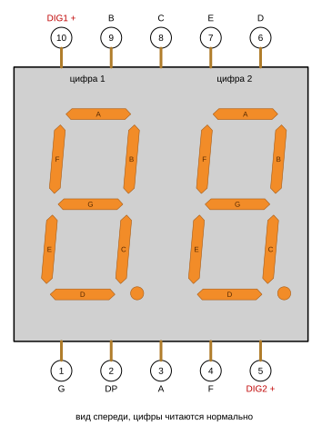

# 5. Учебный скетч: одна цифра

Код: [firmware/one_digit_v2/one_digit_v2.ino](../firmware/one_digit_v2/one_digit_v2.ino)

Самый простой способ понять, как индикатор показывает цифры. Скетч зажигает **одну** цифру и оставляет её гореть: без динамической индикации, без битовых масок, без режимов и команд. Всё происходит в `setup()`, `loop()` пустой.

Подключение то же, что у основной прошивки, — [03-hardware.md](03-hardware.md), ничего перепаивать не нужно.

## Запуск

1. Arduino IDE: **Файл → Открыть** → `firmware/one_digit_v2/one_digit_v2.ino`.
2. В начале файла задать, что показать:
   ```cpp
   const int DIGIT    = 7;   // какую цифру показать: 0..9
   const int POSITION = 1;   // где: 1 — левая цифра, 2 — правая
   ```
3. Плата **DOIT ESP32 DEVKIT V1**, **Загрузка**.
4. На индикаторе горит «7» слева. В мониторе порта (115200, нажать **EN**):
   ```
   === one_digit_v2: показываю 7 на левой цифре ===
     сегмент A: горит   (GPIO 21 = LOW)
     сегмент B: горит   (GPIO 33 = LOW)
     сегмент C: горит   (GPIO 25 = LOW)
     сегмент D: —       (GPIO 27 = HIGH)
     ...
     анод: GPIO 32 = HIGH — цифра включена
   ```

Вернуть основную прошивку — снова залить `firmware/led_clock_v2/led_clock_v2.ino`.

## Как это работает — 4 шага

**1. Цифра — это 7 светодиодов-полосок.** У каждого свой пин ESP32:



**2. Какие полоски зажечь, говорит таблица.** Строка = цифра, столбец = сегмент, `1` — горит:

```cpp
  //A  B  C  D  E  F  G
  { 1, 1, 1, 0, 0, 0, 0 },  // 7  -> горят A, B, C
```

Нарисуйте «7» из полосок — это верх (A) и две правые (B, C). Таблица — ровно это.

**3. Как зажечь одну полоску.** Ток идёт от плюса к минусу:

```
пин анода (HIGH, 3,3 В) → светодиод сегмента → резистор 470 Ом → пин сегмента (LOW, 0 В)
```

| Анод цифры | Пин сегмента | Сегмент |
|---|---|---|
| HIGH | LOW | **горит** — есть разница напряжений, течёт ток |
| HIGH | HIGH | не горит — с обеих сторон 3,3 В |
| LOW | любой | не горит — цифра выключена |

Поэтому в коде «зажечь сегмент» — это `digitalWrite(пин, LOW)`. Звучит наоборот, но так устроен общий анод: плюс общий, а каждый сегмент включается своим «минусом».

**4. Порядок в `setup()`:** все сегменты выключить (HIGH) → обе цифры выключить (LOW) → выставить сегменты по таблице → подать HIGH на анод нужной цифры. Пины сохраняют состояние сами, поэтому в `loop()` делать нечего — цифра горит.

## Упражнения

Каждое — поменять код, залить, посмотреть.

1. **Все цифры.** Перебрать `DIGIT` от 0 до 9. Для каждой сначала угадать по таблице, какие сегменты загорятся.
2. **Правая цифра.** `POSITION = 2` — та же цифра справа: сегменты те же, другой анод (GPIO 23).
3. **Обе цифры сразу.** В шаге 4 подать HIGH на **оба** анода:
   ```cpp
   digitalWrite(LEFT_DIGIT_PIN, HIGH);
   digitalWrite(RIGHT_DIGIT_PIN, HIGH);
   ```
   Загорится одно и то же на обеих: сегменты у цифр **общие** (ножка 3 — это A и левой, и правой). Показать «4» слева и «2» справа одновременно так нельзя.
4. **Буква.** Добавить в таблицу 11-ю строку и показать её (`DIGIT = 10`): например «H» — `{0, 1, 1, 0, 1, 1, 1}` (B, C, E, F, G), «P» — `{1, 1, 0, 0, 1, 1, 1}`.
5. **Два числа по очереди — руками.** Сделать в `loop()`: показать «4» слева на 1 секунду, погасить, показать «2» справа на 1 секунду, и так по кругу. Затем уменьшать задержку: 1000 → 100 → 10 → 2 мс. На каком-то значении мигание исчезнет, и будет казаться, что «42» горит целиком.

Упражнение 5 — это и есть **динамическая индикация**, на которой построена основная прошивка: [`displayRefresh()` в led_clock_v2.ino](../firmware/led_clock_v2/led_clock_v2.ino) делает то же самое каждые 2 мс, а таблица цифр там упакована в байты (`0x07` вместо `{1, 1, 1, 0, 0, 0, 0}` — те же нули и единицы, записанные битами).
