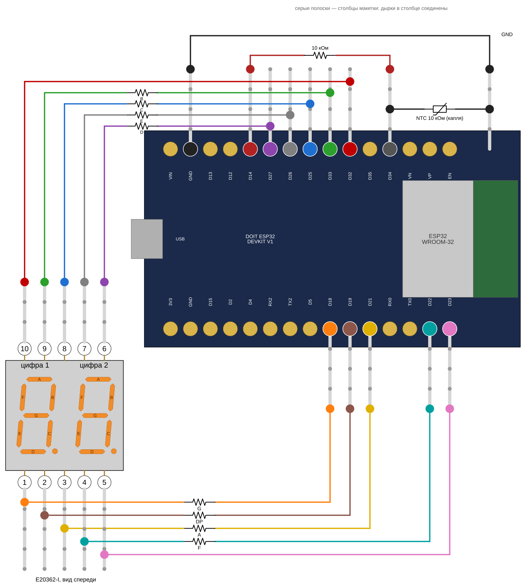

# led_thermometer — термометр на NTC-датчике и индикаторе с платы обогревателя

ESP32 меряет температуру NTC-термистором (капля с платы терморегулятора обогревателя) и показывает её на семисегментном индикаторе [TOYO E20362-I-UA3](docs/components/E20362-I-UA3.md) (2 цифры). Индикатор подключён так же, как в проекте `led_clock_v2` (разводка v2).

```
[NTC-капля] --делитель 10 кОм--> [GPIO34 АЦП] -> [ESP32] -> [E20362 «23»]
```



**С чего начать:** [docs/00-guide.md](docs/00-guide.md) — путеводитель по шагам со ссылками на подробные документы.

## Подключение

| Что | Пины ESP32 |
|---|---|
| Индикатор, ножки 10, 9, 8, 7, 6 | D32, D33, D25, D26, D27 (верхний ряд платы) |
| Индикатор, ножки 1, 2, 3, 4, 5 | D18, D19, D21, D22, D23 (нижний ряд платы) |
| Делитель датчика: питание | D14 → резистор 10 кОм → D34 |
| Датчик (капля NTC 10 кОм) | между D34 и GND |

Сегменты индикатора — через резисторы 470 Ом, аноды (D32, D23) — напрямую. Подробно: [docs/03-hardware.md](docs/03-hardware.md).

**Статус:** собран и проверен на железе (22.11.2026) — в комнате 26,4 °C, в пальцах 34 °C, показания согласуются с расчётом для NTC 10 кОм / B 3950.

## Что показывает

- При включении — самотест сегментов, затем **температура в °C** (целые градусы, −9…99).
- «--» — датчик не подключён или замкнут.
- В мониторе порта раз в 2 с: температура, напряжение на GPIO 34 и сопротивление датчика.

## Структура

```
projects/led_thermometer/
├── docs/
│   ├── components/               # индикатор E20362, датчик NTC 10 кОм, даташиты
│   ├── diagrams/                 # schematics.ipynb -> SVG-схемы для документов
│   ├── 00-guide.md               # путеводитель: все шаги по порядку со ссылками
│   ├── 01-environment-setup.md   # общая установка ESP32
│   ├── 02-firmware.md            # конфиг, калибровка датчика, заливка, лог, команды
│   ├── 03-hardware.md            # схема подключения индикатора и датчика
│   └── 04-troubleshooting.md     # типовые проблемы
└── firmware/
    └── led_thermometer/
        ├── led_thermometer.ino
        └── config.example.h      # необязательный конфиг -> скопировать в config.h
```

## Порядок сборки

| Шаг | Что делаем | ESP32 | Периферия |
|---|---|---|---|
| [00](docs/00-guide.md) | путеводитель: весь путь по шагам с чек-листами | — | — |
| [01](docs/01-environment-setup.md) | среда | по USB | не нужна |
| [02](docs/02-firmware.md) | заливка, проверка лога | по USB | не нужна |
| [03](docs/03-hardware.md) | подключение индикатора и датчика (USB вынут!) | USB вынуть → подключить → вставить | индикатор, 8 × 470 Ом, капля NTC, 10 кОм |

## Быстрый старт

Коротко (подробно, с проверками — [00-guide.md](docs/00-guide.md)):

1. **USB отключён.** Собрать схему по [03-hardware.md](docs/03-hardware.md).
2. Подключить USB, открыть `firmware/led_thermometer/led_thermometer.ino` в Arduino IDE, плата DOIT ESP32 DEVKIT V1, залить (`config.h` не нужен).
3. Монитор порта 115200, нажать **EN**: самотест, затем температура на индикаторе и строки `[TEMP]` в логе.
