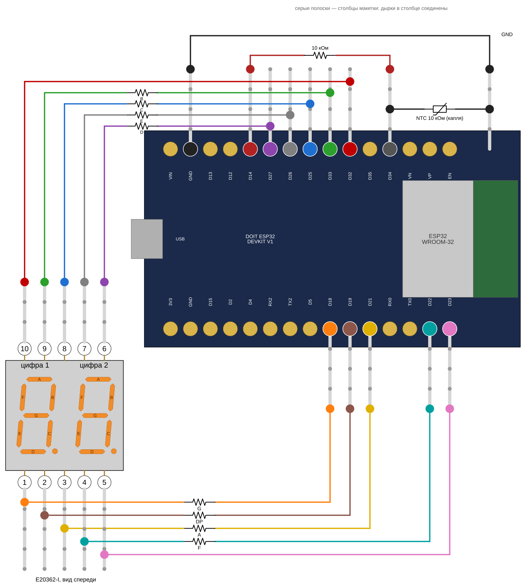

# 0. Путеводитель: от деталей до работающего термометра

Начинайте отсюда. Документ ведёт по шагам и на каждом шаге отправляет в нужный подробный документ. Отмечайте пройденное.

**Цель:** индикатор показывает температуру воздуха в °C, в мониторе порта — точные значения.

## Шаг 1. Детали

- [ ] ESP32 **DOIT DevKit V1** (30 выводов) и USB-кабель **с передачей данных**.
- [ ] Индикатор **TOYO E20362-I-UA3** — [components/E20362-I-UA3.md](components/E20362-I-UA3.md).
- [ ] Датчик — **NTC-капля** с платы терморегулятора — [components/NTC-10k-B3950.md](components/NTC-10k-B3950.md).
- [ ] 8 резисторов **470 Ом**, 1 резистор **10 кОм**, макетная плата, ~13 проводов — [03-hardware.md, 3.2](03-hardware.md#32-что-понадобится).

Индикатор и датчик сняты с платы сетевого обогревателя: саму плату к ESP32 не подключать и не включать.

## Шаг 2. Компьютер (один раз)

- [ ] Arduino IDE, пакет ESP32, драйвер CH9102, COM-порт виден — [01-environment-setup.md](01-environment-setup.md).
- [ ] Внешние библиотеки не нужны.

## Шаг 3. Сборка схемы — USB отключён

- [ ] **USB вынут.**
- [ ] Индикатор: как в led_clock_v2 — [03-hardware.md, 3.3](03-hardware.md#33-схема).
- [ ] Датчик: D14 → резистор 10 кОм → столбец D34; капля — между столбцом D34 и GND — [03-hardware.md, 3.4](03-hardware.md#34-датчик-температуры).

## Шаг 4. Проверка перед включением

- [ ] На **каждом** из 8 проводов сегментов (верхний ряд платы: D33, D25, D26, D27; нижний: D18, D19, D21, D22) есть резистор 470 Ом.
- [ ] Без резисторов к индикатору только **D32 → ножка 10** и **D23 → ножка 5**.
- [ ] Между D14 и D34 — резистор **10 кОм** (не 470 Ом!), а не провод.
- [ ] Капля одной ножкой в столбце D34, другой — в столбце, соединённом с **GND**.
- [ ] К индикатору не подключены 3V3, GND, VIN; голые выводы резисторов не касаются соседних.

## Шаг 5. Заливка прошивки

- [ ] Вставить USB.
- [ ] Arduino IDE: открыть `firmware/led_thermometer/led_thermometer.ino`, плата **DOIT ESP32 DEVKIT V1**, порт `COMx`, **Загрузка** — [02-firmware.md, 2.2](02-firmware.md#22-заливка).
- [ ] Повисло на `Connecting....___` — зажать **BOOT**.

## Шаг 6. Первый запуск

- [ ] Монитор порта **115200**, «Новая строка», нажать **EN** — [02-firmware.md, 2.3](02-firmware.md#23-ожидаемый-лог).
- [ ] Самотест: «8.8.», затем сегменты по одному.
- [ ] Затем на индикаторе — **температура** (например, «23»), в логе раз в 2 с: `[TEMP] 23.4 °C (GPIO34: 1.71 В, датчик 10.74 кОм)`.
- [ ] Зажать каплю в пальцах — через полминуты температура растёт; отпустить — падает.

## Шаг 7 (по желанию). Проверка точности

- [ ] Капля в тающем льду (стакан со льдом и водой = 0 °C): индикатор ~0. Если сильно иначе — подстроить `NTC_BETA` или `TEMP_OFFSET_C` — [02-firmware.md, 2.5](02-firmware.md#25-точность-и-калибровка).

## Если что-то не так

| Что видно | Куда смотреть |
|---|---|
| Нет COM-порта, не заливается | [04-troubleshooting.md](04-troubleshooting.md), первые строки |
| На шаге самотеста не тот сегмент / не горит | строка `[TEST]` из лога → [04-troubleshooting.md](04-troubleshooting.md) |
| На индикаторе «--» | строка `[TEMP]` из лога: обрыв или замыкание датчика → [04-troubleshooting.md](04-troubleshooting.md) |
| Температура явно неверная | [04-troubleshooting.md](04-troubleshooting.md), раздел про датчик |

Любые перестановки проводов — **с отключённым USB**.

## Где что лежит

| Документ | О чём |
|---|---|
| [01-environment-setup.md](01-environment-setup.md) | среда разработки |
| [02-firmware.md](02-firmware.md) | настройки, калибровка датчика, заливка, лог, команды |
| [03-hardware.md](03-hardware.md) | схемы подключения индикатора и датчика |
| [04-troubleshooting.md](04-troubleshooting.md) | симптом → причина → решение |
| [components/](components/) | индикатор, датчик NTC, даташиты |
| [diagrams/schematics.ipynb](diagrams/schematics.ipynb) | исходник всех схем ([как править](../../../docs/diagrams.md)) |
