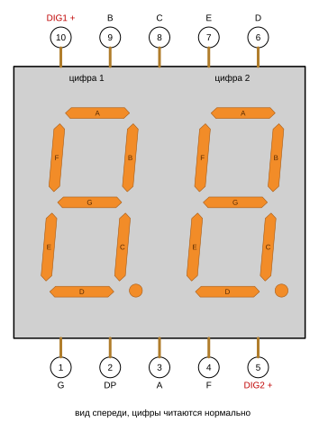
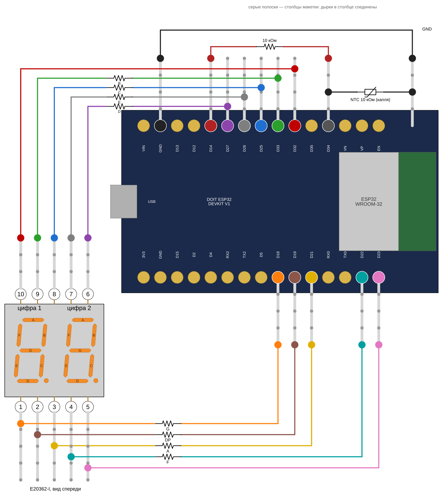
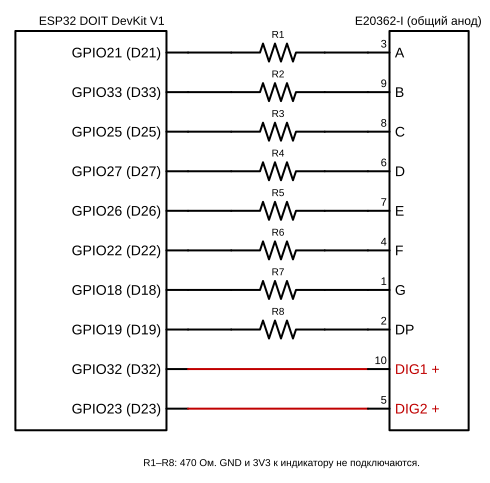
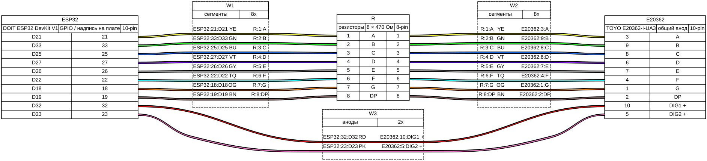

# 3. Подключение

> **Перед подключением отключите USB от ESP32.** Любые перекоммутации — только на обесточенной плате.
>
> Индикатор и датчик сняты с платы сетевого обогревателя (230 В). Саму плату к ESP32 **не подключать** и не включать — используем только снятые детали.

Один индикатор (2 цифры, без транзисторов) — подключён так же, как в led_clock_v2, и датчик температуры — NTC-капля через делитель с резистором 10 кОм.

## 3.1 Индикатор TOYO E20362-I

Маркировка на корпусе — `E20362-I-UA3-8`: 2 цифры высотой 9,2 мм, 10 ножек, **общий анод** (буква `I`), оранжевый.
Подробно (контакты, комбинации, напряжения, даташиты): [components/E20362-I-UA3.md](components/E20362-I-UA3.md).

Сегменты у обеих цифр общие (ножка 3 — это A и левой, и правой цифры). Какая цифра загорится, решает, на какой анод (10 или 5) подан плюс. Поэтому прошивка зажигает цифры по очереди, ~250 раз в секунду каждую, — глазу кажется, что горят обе (мультиплексирование).

## 3.2 Что понадобится

| Компонент | Кол-во |
|---|---|
| ESP32 DOIT DevKit V1 | 1 |
| Индикатор E20362-I | 1 |
| Резистор **470 Ом** (допустимо до 1 кОм — будет тусклее) | 8 |
| Датчик температуры — NTC-капля с платы обогревателя | 1 |
| Резистор **10 кОм** (коричневый-чёрный-оранжевый) — делитель датчика | 1 |
| Макетная плата, провода | ~13 |

Транзисторы не нужны.

## 3.3 Схема

**Монтажная схема** — как на макетке: плата горизонтально (USB слева), индикатор слева внизу, выводы на своих местах. Серые полоски — столбцы макетки: дырки в столбце соединены, провод втыкается в любую свободную.

Расположение выводов — для 30-контактной DOIT ESP32 DevKit V1. Разводка v2: верхний ряд платы → верхний ряд ножек индикатора — ножки 10, 9, 8, 7, 6 ← D32, D33, D25, D26, D27, провода буквой «Г» (влево, затем вниз; провод к ножке 10 — самый верхний). Нижний ряд платы → нижний ряд ножек — ножки 1…5 ← D18, D19, D21, D22, D23, провода вниз, затем влево. Датчик — над проводами индикатора, подробно в 3.4. Провода не пересекаются. **Сверьте надписи на своей плате** перед сборкой.

**Принципиальная схема** — то же подключение без привязки к расположению: каждая линия сегмента — пин ESP32 → свой резистор → вывод индикатора, аноды цифр (красные) — напрямую.

| Ножка индикатора | Сигнал | ESP32 | Надпись на плате | Через |
|---|---|---|---|---|
| **верхний ряд** | | | | |
| 10 | анод левой цифры | GPIO 32 | D32 (верхний ряд платы) | напрямую |
| 9 | B | GPIO 33 | D33 (верхний ряд платы) | резистор |
| 8 | C | GPIO 25 | D25 (верхний ряд платы) | резистор |
| 7 | E | GPIO 26 | D26 (верхний ряд платы) | резистор |
| 6 | D | GPIO 27 | D27 (верхний ряд платы) | резистор |
| **нижний ряд** | | | | |
| 1 | G | GPIO 18 | D18 (нижний ряд платы) | резистор |
| 2 | DP | GPIO 19 | D19 (нижний ряд платы) | резистор |
| 3 | A | GPIO 21 | D21 (нижний ряд платы) | резистор |
| 4 | F | GPIO 22 | D22 (нижний ряд платы) | резистор |
| 5 | анод правой цифры | GPIO 23 | D23 (нижний ряд платы) | напрямую |

Все пины v2 подписаны на плате как `D` + номер GPIO (GPIO32 → `D32`). Ни один не влияет на загрузку платы (не 0, 2, 5, 12, 15).

GND и 3V3 к индикатору не подключаются: плюс даёт GPIO анода, минус — GPIO сегмента (в состоянии LOW).

Пины можно поменять в `config.h` — см. [02-firmware.md](02-firmware.md).

### Для сравнения: схема проводов (WireViz)

Та же схема, нарисованная [WireViz](https://github.com/wireviz/WireViz) — инструментом для схем **жгутов и проводки**. Он показывает не «как устроена цепь», а «какой провод откуда куда идёт и какого он цвета».

Как читать:

| Блок | Что это |
|---|---|
| **ESP32** (слева) | задействованные пины: надпись на плате и номер GPIO |
| **W1**, **W2**, **W3** | не детали, а **группы проводов** (W — wire): W1 — 8 проводов ESP32 → резисторы, W2 — 8 проводов резисторы → индикатор, W3 — 2 провода ESP32 → аноды |
| **R** (в центре) | 8 резисторов, строка = один резистор: слева приходит провод от ESP32, справа уходит к индикатору |
| **E20362** (справа) | выводы индикатора: номер и сигнал |

Строка внутри провода `ESP32:21:D21  YE  R:1:A` = «провод от ESP32 GPIO21 (на плате D21), жёлтый (`YE`), к резистору 1 (линия A)». Цвета — только рекомендация для макетки.

На макетке W2 часто не нужен: ножка резистора втыкается прямо в ряд с ножкой индикатора. Поэтому для сборки удобнее принципиальная схема выше, а WireViz — как подсказка по цветам проводов.

### Почему резисторы 470 Ом – 1 кОм, а не 330

Анод цифры питается прямо от одного GPIO и отдаёт ток **всех** горящих сегментов этой цифры. При «8.» горят 8 сегментов.
Ток сегмента ≈ (3,3 В − ~2 В на сегменте) / R:

| Резистор | Ток сегмента | Ток пина анода при «8.» | |
|---|---|---|---|
| 1 кОм | ~1,3 мА | ~10 мА | безопасно, яркость умеренная |
| **470 Ом** (выбрано) | ~2,8 мА | ~22 мА | ярче, в пределах возможностей пина |
| 330 Ом | ~4 мА | ~32 мА | слишком близко к пределу 40 мА — **только с транзисторами** |

Прошивка выставляет пинам анодов максимальную нагрузочную способность (`GPIO_DRIVE_CAP_3`). Яркость упрётся в этот предел. Сделать ярче можно на этапе с PNP-транзисторами (тогда подойдут и 330 Ом).

## 3.4 Датчик температуры

Капля — NTC-термистор 10 кОм (B 3950): чем теплее, тем меньше сопротивление. Подробно, с замерами: [components/NTC-10k-B3950.md](components/NTC-10k-B3950.md).

ESP32 не меряет сопротивление напрямую — только напряжение. Поэтому капля включена в **делитель** с резистором 10 кОм:

| Откуда | Куда | Через |
|---|---|---|
| D14 (GPIO 14, верхний ряд платы) | столбец D34 | резистор **10 кОм** |
| столбец D34 (GPIO 34) | свободный столбец правее EN | **капля** (любой стороной) |
| GND (верхний ряд платы) | тот же свободный столбец | провод |

- **GPIO 34** — вход АЦП1: только вход (нам и нужен вход) и работает вместе с Wi-Fi (АЦП2 при включённом Wi-Fi недоступен).
- **GPIO 14** — питание делителя: прошивка ставит его в HIGH (3,3 В). Вывод 3V3 платы закрыт проводами индикатора, а делителю нужно всего ~0,2 мА — пин справляется с запасом.
- **Полярности нет**: капля — это резистор, ножки можно менять местами.
- Напряжение на GPIO 34: при 0 °C ≈ 2,5 В, при 25 °C ≈ 1,65 В, при 40 °C ≈ 1,1 В — середина диапазона АЦП, там он точнее всего.

## 3.5 Включение

1. Ещё раз сверить провода по таблице 3.3, проверить, что на каждой линии сегмента есть резистор.
2. Подключить USB, открыть монитор порта 115200.
3. Смотреть на индикатор во время самотеста:
   - 1,2 с горит «8.8.» — все сегменты обеих цифр;
   - затем по одному сегменту: левая цифра A, B, C, D, E, F, G, DP, потом правая. Каждый шаг пишется в лог с номерами ножек;
   - после этого — **температура в °C** (целые градусы). В логе раз в 2 с: `[TEMP] 23.4 °C  (GPIO34: 1.71 В, датчик 10.74 кОм)`;
   - «--» на индикаторе — датчик не подключён или замкнут, в логе будет причина.
4. Если на каком-то шаге загорелся не тот сегмент или ничего не горит — запомнить строку `[TEST]` из лога и смотреть [04-troubleshooting.md](04-troubleshooting.md).

Дальше: [04-troubleshooting.md](04-troubleshooting.md).
